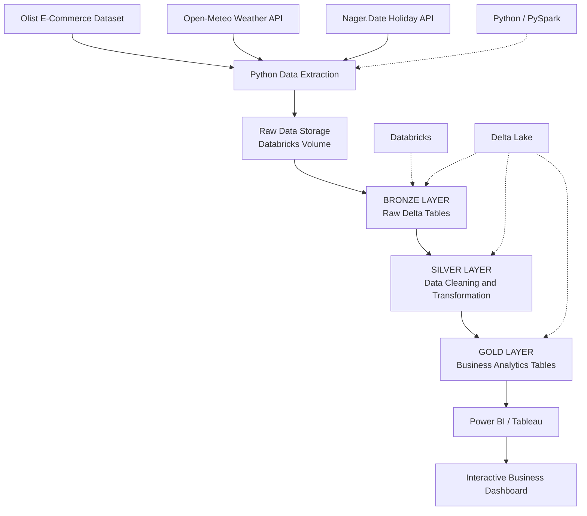

# Project Architecture Diagram

## E-Commerce Customer Behaviour and Sales Intelligence

The following diagram represents the end-to-end architecture of the project.

## Architecture Explanation

### Layer 1: Data Extraction
- Olist Brazilian E-Commerce dataset.
- Open-Meteo historical weather API for São Paulo.
- Nager.Date Brazilian public holidays API.
- Python scripts for data extraction and validation.

### Layer 2: Data Engineering
- Databricks is used as the data processing environment.
- Apache Spark and PySpark perform transformations.
- Delta Lake stores data in Bronze, Silver and Gold layers.

### Layer 3: Data Visualization
- Gold analytical tables are provided to the dashboard team.
- Power BI or Tableau is used to develop interactive dashboards.
- Dashboards help analyze sales, customers, products, payments, deliveries and reviews.

## Data Flow

Data Sources → Python Extraction → Raw Storage → Bronze → Silver → Gold → Power BI / Tableau Dashboard.
